# Herald for Pebble

Herald's Pebble watchapp: talk to Hermes from the watch, read the reply as it comes, answer an approval or a
question, and pick up when Hermes calls. It works through Herald on the phone, which holds the gateway connection
and the sign-in, the way the Wear OS app does. The watch never talks to the gateway itself.

It runs on every Pebble with a microphone: Pebble Time, Time Round, Pebble 2, Pebble 2 Duo, Pebble Time 2 and
Pebble Round 2. The plan behind it, what was tested on a device, and the known limits are in
[docs/pebble.md](../docs/pebble.md).

## Screenshots

From the emulator (Pebble Time 2, and Round 2 at the end), with sample chats.

| Talking | At work | Hold Select | Prompts |
|:---:|:---:|:---:|:---:|
| 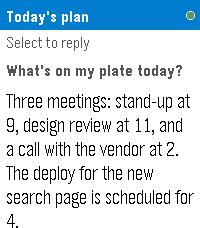 | 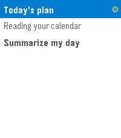 | 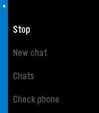 | 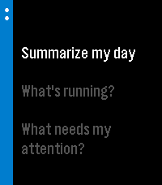 |
| **Chats** | **A question** | **Answering it** | **An approval** |
| 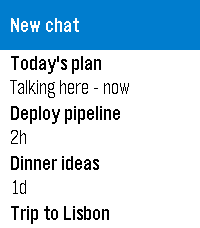 | 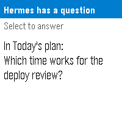 | 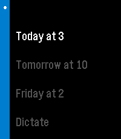 | 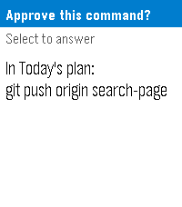 |
| **Hermes calling** | **Launcher glance** | **Switched off** | **Round 2** |
| 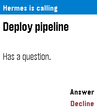 | 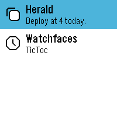 | 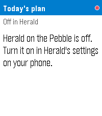 | 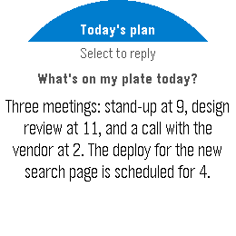 |

On the phone, **Settings → Pebble** has the two switches the watchapp answers to:

| Light | Dark |
|:---:|:---:|
| 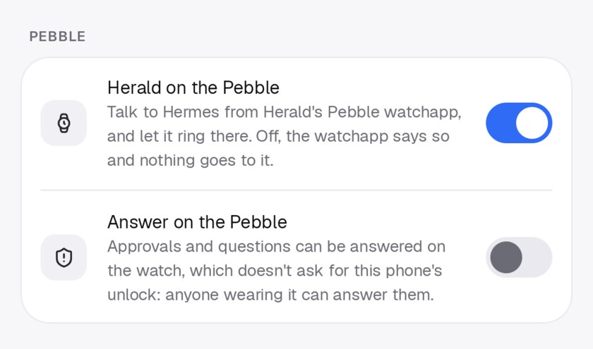 | 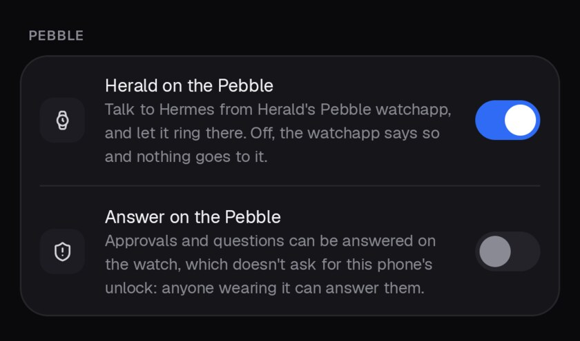 |

- **Herald on the Pebble** (on): off, the watchapp says so and Herald sends it nothing: no turns, no rings, no
  questions.
- **Answer on the Pebble** (off): approvals and questions can be answered on the watch, as they come or when it
  rings. It's off by default because the watch doesn't ask for the phone's unlock: anyone wearing it can answer.

Rings are turned on in **Settings → Phone tools → Calls**, the same as for a Wear OS watch: ringing for answers,
and **Ring my watch too**.

## Install

1. Install Herald on the phone and sign in to your gateway.
2. Download `herald-pebble-<version>.pbw` from the same [release](https://github.com/Giton22/herald/releases/latest)
   and open it on the phone. The Pebble app installs it on the watch.
3. Open Herald on the watch once. The phone only rings watches it has heard from.

## Using it

| Button | Talk screen |
|---|---|
| **Select**, or a tap on touch models | Dictate and send to Hermes |
| **Up / Down**, or a drag | Scroll the reply |
| **Hold Select** | Stop the turn, Prompts, New chat, Chats, Check phone |
| **Back** | Close Herald |

- **Chats:** each chat opens on its last exchange. The watch keeps the chat it talks in across launches.
- **A finished reply while Herald is closed** comes as the phone's usual reply notification, which the Pebble app
  shows on the watch.
- **Approvals and questions** in the watch's chat show on the watch when answering there is on. A single question
  is answered by picking a choice or dictating. Multi-select and batches of questions, passwords and logins stay
  on the phone.
- **Rings:** when Hermes calls for an answer, the phone opens Herald on the watch, which buzzes and, on models with
  a speaker (Time 2, Pebble 2 Duo, Round 2), plays a ringtone.
  - **Select** answers. With answering on the watch, the question opens there and the phone stops. Otherwise the
    watch goes quiet and says to answer on the phone, which keeps ringing.
  - **Down** declines, and the phone stops too.
  - **Back** quiets the watch only.
- **Quick launch** (the watch's Settings → Quick Launch) opens straight into dictation.
- **Glance:** the app list shows the last reply's first line under Herald, or "Working on it..." when Herald was
  closed mid-turn.

## Build

The watchapp is C, built with Pebble's own tools, which need Python 3.13 or older:

```bash
uv tool install --python 3.13 pebble-tool
```

```bash
pebble sdk install latest
```

```bash
pebble build
```

`build/pebbleApp.pbw` holds every model. Installing the SDK prints Pebble's
[developer terms](https://developer.repebble.com/legal/sdk-license/). CI builds the watchapp on every pull request,
and a release attaches it as `herald-pebble-<version>.pbw` (see `.github/workflows`).

For Herald on the phone to take the watch's messages, its package has to be in `companionApp` in
`package.json`. `dev.herald.android` and `dev.herald.android.dev` (Herald Dev) are.

## Try it

On the emulator, the phone's side is played with `pebble send-app-message`, the keys being the numbers in
`package.json`'s `messageKeys`. Give each type (`--int`, `--string`) once, followed by all its keys:

```bash
pebble install --emulator emery
```

```bash
pebble send-app-message --emulator emery --int 1=64 3=1 4=4 6=0 7=5 --string 2=p1 5=Hello 11=c1 9="A chat"
```

That's a finished reply (type 64, phase 4). A question is type 69, a ring type 67, the phone's status type 66.
`pebble emu-button`, `pebble transcribe` (for dictation) and `pebble screenshot` drive the rest.

On a phone over USB, `pebble install --adb` installs on the watch, and `adb logcat -s HeraldPebble` shows each
message Herald sends and takes.

## How it fits together

The phone keeps speaking WearLink's JSON to `WatchRelay`, as for a Wear OS watch. For a Pebble,
`PebbleOutbox` turns each message into a small AppMessage dictionary, and `PebbleBridgeService` reads what the
watch sends back. Both go through PebbleKit 2 and the Pebble app, which wakes Herald when it's closed. The
dictionaries, their keys and types are in
[`PebbleLink.kt`](../shared/wearlink/src/commonMain/kotlin/dev/hermeskotlin/wearlink/PebbleLink.kt), and a test
keeps them in step with `package.json`.

| File | What it is |
|---|---|
| `src/c/main.c` | Opens the link and hands each message to its screen |
| `src/c/link.c` | The messages to and from the phone, read into plain structs |
| `src/c/talk.c` | The talk screen, the hold-Select menu, quick launch, the glance and touch |
| `src/c/chats.c` | The chat list |
| `src/c/request.c` | An approval or a question, answered on the watch |
| `src/c/ring.c` | Ringing for a call from Hermes |
| `src/c/dictate.c` | Dictation for the whole app: one session, its text going to whoever asked |
| `src/c/layout.c` | Round and rectangular screens |
